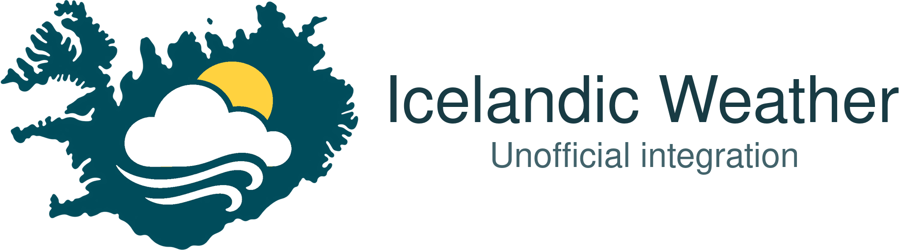

# Project Branding

## Independent, Unofficial Identity

This is an unofficial community integration, not an IMO product. The English
wordmark reads **Icelandic Weather** with **Unofficial integration** underneath.
The Home Assistant integration name and domain (`vedur_is`) are unchanged.

<picture>
  <source media="(prefers-color-scheme: dark)" srcset="custom_components/vedur_is/brand/dark_logo@2x.png">
  
</picture>

No official IMO logo or windrose is bundled. Although the
[English logo page](https://en.vedur.is/about-imo/publications/logos/)
offers downloads, the
[Icelandic logo page](https://vedur.is/um-vi/merki-vedurstofu-islands/)
explicitly states:

> Notkun merkis Veðurstofunnar opinberlega er óheimil án samþykkis stofnunarinnar.

In English: public use of the IMO logo requires the organisation's approval.
We have not obtained that approval, so the integration uses its own artwork.
The provider's [weather-data terms](https://en.vedur.is/about-imo/the-web/conditions)
are separate from permission to use its logo. Checked on 2026-10-31.

## Home Assistant Assets

The PNG files live in `custom_components/vedur_is/brand/`, using Home Assistant's
[local brand support](https://contributors.home-assistant.io/blog/2026/02/24/brands-proxy-api/)
(2026.3+), not the upstream brands repository. No manifest flag, remote image
dependency, frontend resource, or integration setup code is required.

All eight variants follow the
[Home Assistant image specification](https://github.com/home-assistant/brands#image-specification):

| Files | Dimensions |
| --- | --- |
| `icon.png`, `dark_icon.png` | 256 x 256 |
| `icon@2x.png`, `dark_icon@2x.png` | 512 x 512 |
| `logo.png`, `dark_logo.png` | Landscape; 256 px shortest side |
| `logo@2x.png`, `dark_logo@2x.png` | Landscape; 512 px shortest side |

Images are transparent, interlaced, losslessly PNG-compressed and stripped of
unneeded metadata. The artwork's aspect ratio is preserved. Square icons use
only the padding needed to fit the non-square silhouette. Dark variants lighten
the teal silhouette and use light lettering, retaining the same geometry.

## Artwork and Rebuilding

`branding/mark.png` is the project-specific high-resolution raster master.
The mark was created with the built-in OpenAI image-generation tool, without
using any IMO logo as an input. `branding/prompt.txt` records the prompt. The
English lettering is rendered locally using Nimbus Sans, rather than generated
text. No font files are redistributed.

The local build cleans near-transparent edge noise, flattens the mark to a
teal/white/yellow palette without dithering, and resizes using Lanczos filtering.

With ImageMagick 7 and the URW Base35 Nimbus Sans fonts installed, run:

```bash
bash scripts/build_brand_assets.sh
```

The script only reads local project artwork and creates the eight brand PNGs;
it does not download, publish, or submit anything. Pillow is a test-only
dependency for checking the files. Neither Pillow nor ImageMagick is added to
the integration's runtime requirements.
